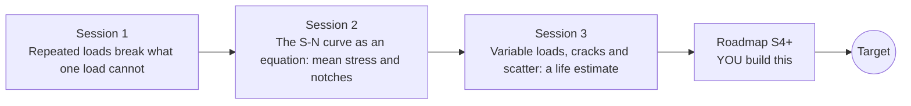

# openfatigue

[](https://github.com/KrunalPanchal1995/openfatigue/actions/workflows/ci.yml)   [](https://colab.research.google.com/github/KrunalPanchal1995/openfatigue/blob/main/sessions/session-01/lesson.ipynb) [](https://krunalpanchal1995.github.io/openfatigue/)

**Predict how many load cycles a part survives, from the paper clip to the S-N curve.**

openfatigue teaches why parts break under repeated loading and how to estimate their life: S-N curves, mean stress, notches, rainflow counting, Miner's rule and crack growth, using only Python and a browser.

- **Start from a paper clip.** Session 1 needs only school algebra and one idea: repeated loading, not one big load, breaks parts.
- **See it move.** Every session ships a slider app that runs in the browser, with labelled graphs.
- **Know you got it right.** Each session ends with a checkpoint that prints PASS or FAIL against hand calculations, including a rainflow counter checked on a hand-traced sequence.
- **Build the missing half.** The repo stops at Session 3 on purpose; the roadmap shows the path to the Target.

[Target](#the-target) · [Who is this for](#who-is-this-for) · [Quick start](#quick-start) · [Sessions](#sessions) · [Roadmap](#roadmap) · [Contribute](#contribute) · [Explainer PDF](docs/explainer.pdf)

> **This repo is incomplete on purpose.** Sessions 1 to 3 are here and fully working. The finished Target below is a preview of what the community can build next. We show you the path, not the code. Sessions 4 and up are yours.

## The Target

A plate with a hole is loaded again and again. On the left an operating point crawls along the S-N curve until it hits the curve and a crack starts at the edge of the hole. On the right the crack grows, slowly at first and then faster, while two bars fill: Miner's damage sum up to 1 and the crack length up to its critical value. Your goal over the coming sessions: build that whole life story yourself, from first cycle to fracture.


*Target: operating point on the S-N curve, a crack growing from a hole, damage bars filling*


*Four stages of the Target: intact, crack starting, crack growing, fracture*


*A still from the Target during crack growth*

Try it live:

- [Math Visual Studio: interactive maths playground](https://krunalpanchal1995.github.io/studio/)

How the Target was made is shown only as a path in [promo/roadmap.md](promo/roadmap.md).

## Who is this for
**diploma / undergraduate to advanced undergraduate (levels 5-6).** Topic area: Mechanical Engineering.

Prerequisites:

- School algebra: powers, logarithms and a straight line on a graph.
- Python 3.10 or newer; if `python --version` works, you are ready. PRIMER.md explains the rest.
- No prior GitHub, materials or fatigue knowledge is needed. Sessions 2 and 3 use stress in MPa and a little calculus ideas, all explained.

New to Python? Read [PRIMER.md](PRIMER.md) first (10 minutes).

## Quick start

No installation knowledge needed. You need [Git](https://git-scm.com/downloads) and [Python 3.10+](https://www.python.org/downloads/) (Windows: tick "Add Python to PATH"). On Mac and Linux type `python3` wherever this page says `python`.

```bash
git clone https://github.com/KrunalPanchal1995/openfatigue.git
cd openfatigue
python start.py 1
```

`start.py` creates a private environment, installs what is needed and runs Session 1 with its checkpoint. Next: `python start.py 2`, `python start.py 3`, or `python start.py test` to check everything. Only a checkpoint: `python start.py check 1`.

Four lines turn the idea of Session 1 into a result (they work as they are): Save it as `try.py` and run it with `python start.py run try.py` (this uses the private environment, where NumPy is installed):

```python
import numpy as np
b = -np.log10(0.9 * 600 / 300) / 3             # S-N exponent of an illustrative steel
A = (0.9 * 600) ** 2 / 300                      # S_a = A * N**b
print(round((400 / A) ** (1 / b)))              # -> 34017 cycles at a 400 MPa amplitude
```

Every session also opens in your browser with sliders (no install): [live apps](https://krunalpanchal1995.github.io/openfatigue/). Or use the Colab badge above for the notebook.

## Sessions

| # | Session | Model level | Time | Live app |
|---|---|---|---|---|
| 1 | [Repeated loads break what one load cannot](sessions/session-01/README.md) | Level 1: conceptual interactive model | 60 min | [open](https://krunalpanchal1995.github.io/openfatigue/session-01/) |
| 2 | [The S-N curve as an equation: mean stress and notches](sessions/session-02/README.md) | Level 2: mathematical engineering model | 75 min | [open](https://krunalpanchal1995.github.io/openfatigue/session-02/) |
| 3 | [Variable loads, cracks and scatter: a life estimate](sessions/session-03/README.md) | Level 3: simulation and validation | 90 min | [open](https://krunalpanchal1995.github.io/openfatigue/session-03/) |

Each session follows the same six steps: A real-world problem, B concept and theory, C visual explanation, D interactive simulation, E worked example and experiment, F assessment and design challenge. Each ends with `checkpoint.py`, which prints `PASS` or `FAIL` against reference numbers. Session 3 also contains the real-world mini-project: **Bracket life and inspection interval from a load history**.

## Architecture



| Folder or file | What is inside |
|---|---|
| `sessions/` | three sessions: README (A-F), `lesson.py`, notebook, live app, exercises, activity sheet, checkpoint |
| `promo/` | the Target: media, live links, and the roadmap (path only) |
| `docs/` | `explainer.tex` and the built `explainer.pdf` |
| `tests/` | runs every lesson and checkpoint headless |
| `start.py` | one command to set up and run anything |
| `QUALITY.md`, `RUBRIC.md` | the quality checklist and the scoring rubric |
| `.github/` | CI, PDF build, Pages deploy, issue and PR templates |

## Roadmap

| Milestone | What you will build | Difficulty |
|---|---|---|
| Session 4: Fatigue notch factor K_f | A function that returns K_f between 1 and K_t from the notch radius and the material, used in the plate-with-hole life. | intermediate |
| Session 5: Beyond the straight line: low cycles and the knee | A strain-life curve with an elastic and a plastic part, joined to the S-N line. | advanced |
| Session 6: Reliability design life | A function that gives the design life for a chosen reliability from the median life and the log scatter. | intermediate |
| Session 7: Overload retardation in crack growth | A crack growth integrator that tracks the overload plastic zone and slows growth behind it. | advanced |
| Session 8: Reproduce the Target: initiation plus propagation | An animation with an S-N operating point, a plate with a growing crack and two bars. | advanced |

Full detail with a checkpoint per milestone: [promo/roadmap.md](promo/roadmap.md).

## Contribute
New to GitHub? Read [CONTRIBUTING.md](CONTRIBUTING.md); it starts from zero. Pick an issue labelled `good first issue`. Translations into Hindi, Telugu, Tamil and Malayalam are welcome.

<details>
<summary>Development</summary>

```bash
python start.py test        # runs every lesson and checkpoint
```
Lessons use `# %%` cell markers so they open as notebooks in VS Code. See [QUALITY.md](QUALITY.md) for the standard every session meets.
</details>

## License
MIT. See [LICENSE](LICENSE). Media in `promo/media` is (c) Krunal Panchal, CC BY 4.0.

## Acknowledgments
Part of the [PAN IIT OSS](https://hellofoss.tech-iitb.org/projects) open-source teaching collection, modelled on the structure of [openspline](https://github.com/openspline/openspline). Built on ideas from the Math Visual Studio at https://krunalpanchal1995.github.io/studio/.
