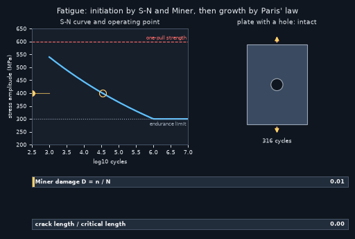
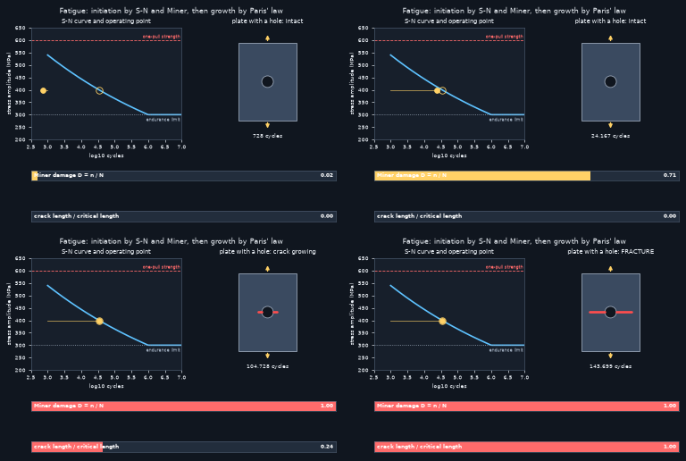
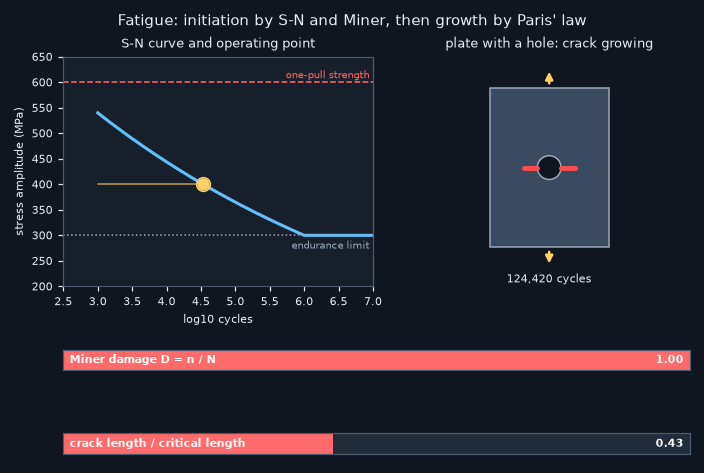

# What you are building toward

A plate with a hole is loaded again and again. On the left an operating point crawls along the S-N curve until it hits the curve and a crack starts at the edge of the hole. On the right the crack grows, slowly at first and then faster, while two bars fill: Miner's damage sum up to 1 and the crack length up to its critical value. Your goal over the coming sessions: build that whole life story yourself, from first cycle to fracture.

*Target: operating point on the S-N curve, a crack growing from a hole, damage bars filling*

*Four stages of the Target: intact, crack starting, crack growing, fracture*

*A still from the Target during crack growth*

These results come from a private reference build. The code is not published; the roadmap shows the path so you can build your own.

Live links:

- [Math Visual Studio: interactive maths playground](https://krunalpanchal1995.github.io/studio/)
