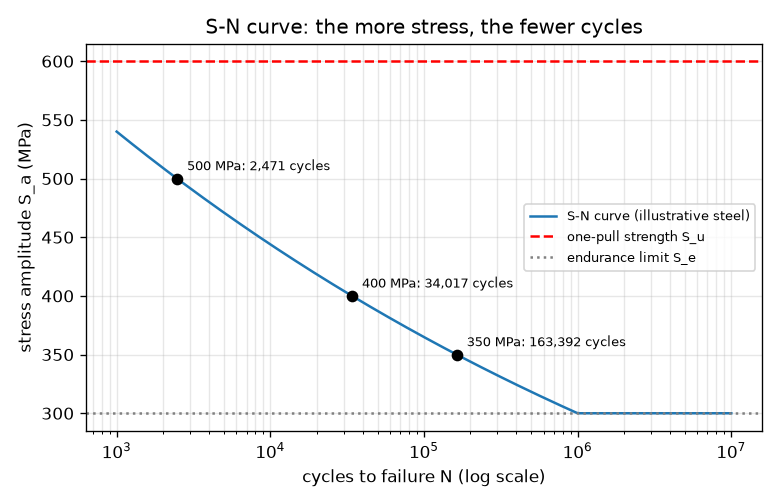
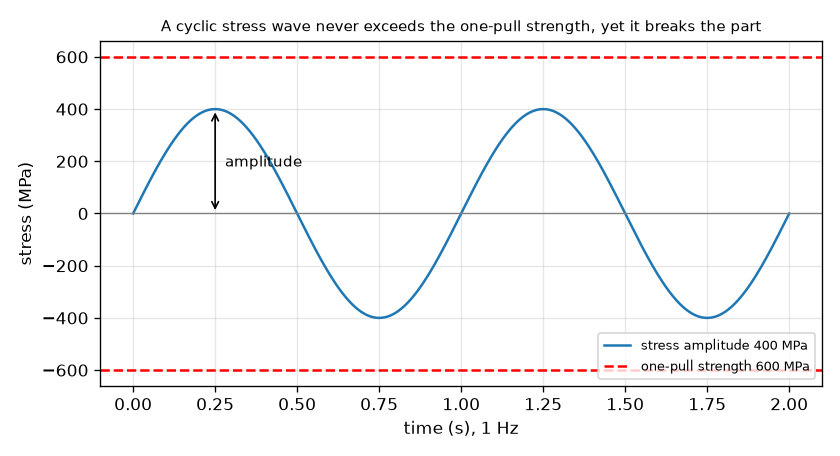

# Session 1: Repeated loads break what one load cannot

*Level 1 (conceptual interactive model) · about 60 minutes · openfatigue*

> This is a simplified educational model. It is not a validated design tool and must not be used for real structures, electrical installations, vehicles, industrial processes or medical decisions.

**Prerequisites**

- School algebra: powers and logarithms.
- You have read PRIMER.md and run `python start.py 1` once.

**Learning objectives.** After this session you can:

- Explain why a part can fail under a repeated stress that is below its one-pull strength.
- Read a cyclic stress wave: amplitude, range, mean and cycle.
- Use the S-N relation S_a = A N^b to turn a stress amplitude into a number of cycles and a running time.
- Say what the endurance limit means for a steel part.

## A. Real-world problem
Bend a paper clip once and it springs back. Bend it back and forth and it snaps, even though no single bend was harder than the first. Bridges, axles, springs and aircraft skins fail in the same quiet way: the damage builds up cycle after cycle. Engineers must answer a practical question: if a part sees a given stress again and again, how many cycles does it survive? (Educational model with illustrative numbers; never use it to design a real part.)

## B. Concept and theory
A rotating shaft that is bent sees each surface point go from pull to push and back: the stress is a wave, stress = S_m + S_a sin(2 pi f t), with mean S_m, amplitude S_a and frequency f. One full wave is one cycle. The range is twice the amplitude. If many identical bars are each tested at a different amplitude and the cycles N until they break are counted, the points fall close to a straight line when both axes are drawn on logarithmic scales. That line is Basquin's relation S_a = A N^b. The exponent b is negative (more stress, fewer cycles) and for typical steels it is about -0.1; our illustrative steel has b = -0.085, because the line is drawn through 0.9 S_u at 1000 cycles and through the endurance limit S_e at one million cycles. Many steels show an endurance limit, about half of S_u, below which the test bars survive a very long time.

| Symbol | Meaning | Unit |
|---|---|---|
| S_a | stress amplitude (half the range) | MPa |
| S_u | ultimate (one-pull) strength, 600 here | MPa |
| S_e | endurance limit, 300 here (0.5 S_u) | MPa |
| N | cycles to failure | cycles |
| A, b | constants of the S-N line; A = 972 MPa, b = -0.085 here | MPa, no unit |
| f | loading frequency | Hz (cycles per second) |

**Assumptions**

- Fully reversed stress (mean zero) on a small polished bar.
- The numbers describe a generic illustrative steel, not a real alloy.
- Below S_e we predict no failure (true for many steels, not for aluminium).
- Simplified teaching model: never a design method for real parts.

$$ S(t)=S_m+S_a\sin(2\pi f t),\qquad \Delta S = 2S_a $$

$$ S_a=A\,N^{\,b},\qquad N=\left(\frac{S_a}{A}\right)^{1/b} $$

$$ b=-\frac{1}{3}\log_{10}\frac{0.9\,S_u}{S_e},\qquad A=\frac{(0.9\,S_u)^2}{S_e} $$

$$ t_{\mathrm{fail}}=\frac{N}{f} $$

## C. Visual explanation
The first figure shows a stress wave of amplitude 400 MPa. Its peaks stay below the red dashed line of the 600 MPa one-pull strength, yet the part fails after enough cycles. The second figure is the S-N curve on a logarithmic cycle axis: it falls from 540 MPa at 1000 cycles to the endurance limit of 300 MPa at one million cycles, then runs flat. Three marked points show that 500 MPa lasts about 2,500 cycles, 400 MPa about 34,000 and 350 MPa about 163,000.

*The S-N curve of the illustrative steel with three marked operating points and the endurance limit.*

*A 400 MPa amplitude wave stays well below the 600 MPa one-pull strength, yet it breaks the part after enough cycles.*

## D. Interactive simulation
Run the lesson (`python start.py 1`), then open the live app: [Session 1: stress wave and S-N curve](https://krunalpanchal1995.github.io/openfatigue/session-01/) (or `app.html` in this folder). Move the amplitude slider and watch the wave grow, then open the S-N view and see the operating point slide along the curve. Change the frequency and see how the running time to failure changes while the number of cycles does not.

**Challenge.** Pick a stress amplitude at which the model predicts no fatigue failure.

## E. Worked example and experiment
**Problem.** A steel bar (S_u = 600 MPa, S_e = 300 MPa, so A = 972 MPa and b = -0.085) is loaded with a fully reversed amplitude of 400 MPa at 10 Hz. How many cycles does it survive and for how long does it run?

1. Check the model applies: 400 MPa is above S_e = 300 MPa, so the life is finite, and below S_u = 600 MPa, so one pull would not break it.
2. N = (S_a / A)^(1/b) = (400 / 972)^(1 / -0.0851). Here 400 / 972 = 0.4115, log10(0.4115) = -0.3856, and 1/b = -11.75.
3. log10 N = -0.3856 x -11.75 = 4.53, so N = 10^4.53 = 34,000 cycles (34,017 with more digits).
4. Running time = N / f = 34,017 / 10 = 3,402 s = 56.7 minutes.
5. Sanity check: 400 MPa lies between the 540 MPa at 1000 cycles and the 300 MPa at one million cycles, so a life between 1,000 and 1,000,000 cycles is right.

**Answer.** About 34,000 cycles, which is about 57 minutes at 10 Hz.

**Experiment.** Bend a paper clip through the same angle (say 90 degrees) back and forth and count the bends until it snaps; repeat with five clips and compare your counts. You will get a range, not one number, and it differs from any formula here because the clip is bent far beyond its elastic range, so it fails after far fewer cycles than the thousands our line predicts: this is the low-cycle regime where our high-cycle S-N line does not apply. The model is a straight line for a perfect bar; real parts scatter around it.

## F. Assessment and design challenge
**Question type A: Conceptual.** Why can a part break under a repeated stress that is smaller than the stress needed to break it in one pull? What does the part 'remember' from one cycle to the next?

Hint

Think of the paper clip: what changes inside it with every bend?

Step-by-step solution

Each cycle causes a tiny amount of permanent damage, mostly at microscopic places where stress is highest (a scratch, a corner, a grain boundary). The damage is not undone when the load is removed, so it accumulates until a crack forms and grows. One pull below S_u causes no such accumulating damage, but many repetitions do. The part 'remembers' its accumulated damage, not the load itself.

**Question type B: Numerical.** The same steel is loaded at an amplitude of 350 MPa and 20 Hz. Find the number of cycles to failure and the running time in hours. Check that the answer is sensible.

Hint

N = (S_a / A)^(1/b) with A = 972 MPa and b = -0.0851; time = N / f.

Step-by-step solution

N = (350 / 972)^(-11.75) = 163,392 cycles (about 163,000). Time = 163,392 / 20 = 8,170 s = 2.27 hours. Sanity check: 350 MPa lies between 300 MPa (one million cycles) and 400 MPa (34,000 cycles), so the life must lie between those two values: it does.

**Question type C: Graph and simulation interpretation.** On the S-N graph, the amplitude is raised from 400 MPa to 500 MPa, a rise of 25 percent. By what factor does the life fall? What does the steep curve tell a designer?

Hint

Read N at both stresses (or compute them) and divide.

Step-by-step solution

N falls from 34,017 to 2,471 cycles, a factor of 13.8 (about 14 times shorter). A 25 percent rise in stress costs more than an order of magnitude of life: fatigue life is very sensitive to stress, so small stress reductions (a larger radius, a slightly thicker section) buy a lot of life.

**Question type D: Design and optimisation challenge.** A rotating bar sees an amplitude of 450 MPa. It must run 8 hours a day at 10 Hz for 30 days. (a) How many cycles is that? (b) How long does it last at 450 MPa? (c) In bending, stress goes as 1/d^3 (d = diameter). By what factor must the diameter grow to bring the stress down to the endurance limit?

Hint

(a) cycles = hours x 3600 x frequency. (b) use the S-N relation. (c) 450 / 300 = (d_new / d_old)^3.

Step-by-step solution

(a) 8 x 3600 x 10 x 30 = 8,640,000 cycles. (b) N at 450 MPa = 8,522 cycles, only 14.2 minutes at 10 Hz. So the bar fails on day one. (c) The stress must fall by 450 / 300 = 1.5, so d_new / d_old = 1.5^(1/3) = 1.145: a diameter 14.5 percent larger brings the amplitude to 300 MPa, the endurance limit. Assumptions: perfect bar, no notches, no safety margin. A real design would add a margin (Session 2).

Score yourself with [RUBRIC.md](../../RUBRIC.md). Print the [activity sheet](activity_sheet.md) to work on paper.

## Common misconceptions
| Common misconception | What is actually true |
|---|---|
| If the load is below the strength, the part is safe. | Below the one-pull strength is safe for one pull only. Repeated loads can break the part after many cycles. |
| A part fails suddenly with no warning, so nothing happens before. | Damage accumulates over many cycles; the failure at the end is sudden, but the crack has been growing for a long time. |
| Doubling the stress halves the life. | Life changes with a high power of stress: here N goes as S_a^(1/b), about S_a^-11.75, so a 25 percent rise in stress cut the life by a factor 13.8. |
| Cycles to failure and time to failure are the same thing. | Time is cycles divided by frequency; the same part lasts 10 times longer in time at 1 Hz than at 10 Hz (in this simple model). |

## Glossary
- **fatigue**: failure caused by repeated (cyclic) loading, even when each load is below the one-pull strength
- **stress amplitude**: half the difference between the highest and lowest stress of a cycle, in MPa
- **cycle**: one full repetition of the load: up, down and back
- **S-N curve**: graph of stress amplitude against cycles to failure, usually with a logarithmic cycle axis
- **endurance limit**: stress amplitude below which a steel part may last a very long time
- **MPa**: megapascal, one million newtons per square metre; the unit of stress

## Finish
1. Do the three coding tasks in [exercises.md](exercises.md).
2. Run `python start.py 1` again after your changes. It ends with the checkpoint; when it prints `PASS`, you are done. (Checkpoint only: `python start.py check 1`.)

Next: [Session 2](../session-02/README.md)
