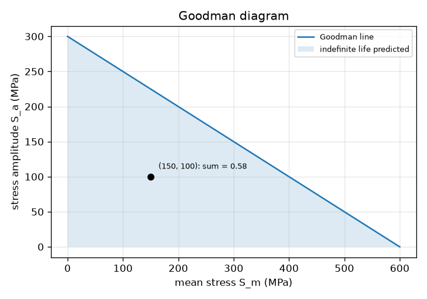
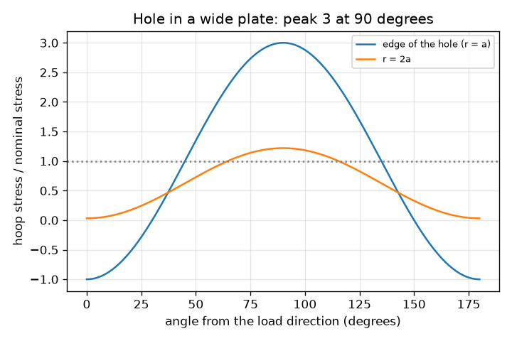
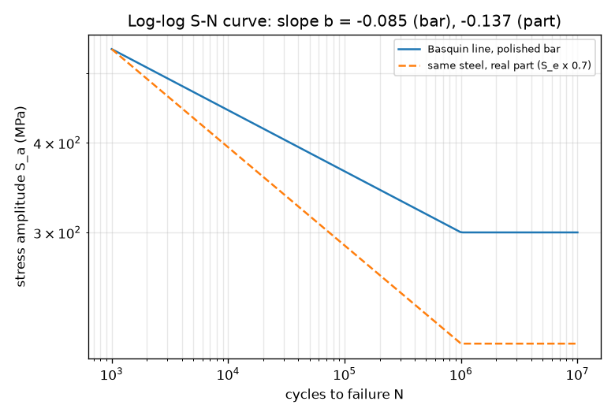

# Session 2: The S-N curve as an equation: mean stress and notches

*Level 2 (mathematical engineering model) · about 75 minutes · openfatigue*

> This is a simplified educational model. It is not a validated design tool and must not be used for real structures, electrical installations, vehicles, industrial processes or medical decisions.

**Prerequisites**

- Session 1: the S-N relation S_a = A N^b and the endurance limit.
- Logarithms; the idea of a stress in MPa.

**Learning objectives.** After this session you can:

- Build the Basquin line S_a = A N^b for any S_u and S_e and invert it for life and for stress.
- Apply the Goodman line S_a / S_e + S_m / S_u = 1 and the equivalent amplitude for a load with mean stress.
- Explain stress concentration and use K_t = 3 for a hole in a wide plate.
- Size a rotating shaft for 10^6 cycles and beyond with a safety margin, and say what changes with a shoulder (K_t = 2).

## A. Real-world problem
A shaft carries a pulley load and turns at 1500 revolutions per minute (25 per second): each surface point is pulled and pushed once per revolution, so about 11 hours of running make a million cycles. What diameter keeps it safe for 10^6 cycles and beyond, with a margin? On the way we meet the two things that shorten life most: a mean stress (a load that never fully reverses) and a notch such as a hole or sharp shoulder. All numbers are illustrative; this is a simplified model, not a design method for real shafts.

## B. Concept and theory
Basquin's relation S_a = A N^b is a straight line on log-log axes. We anchor it at 0.9 S_u for 1000 cycles and at S_e for 10^6 cycles, which gives b = -(1/3) log10(0.9 S_u / S_e) and A = (0.9 S_u)^2 / S_e. For the polished bar (S_e = 300 MPa) b = -0.085; for a real part with a lower endurance limit (210 MPa, which is 0.7 of 300 for surface finish and size, an illustrative factor) the line is steeper, b = -0.137. Both are close to the 'typical' value of about -0.1 quoted for steels. Mean stress: a tensile mean opens cracks and shortens life; the Goodman line S_a / S_e + S_m / S_u = 1 separates combinations below it (indefinite life predicted) from those above it. For a load with mean we convert to the equivalent fully reversed amplitude S_eq = S_a / (1 - S_m / S_u) and use the S-N line. Notches: near a hole or corner the local stress is K_t times the nominal one. For a hole in a wide plate under uniaxial stress the exact elastic hoop stress at the edge is S (1 - 2 cos 2 theta), which peaks at 3 S at theta = 90 degrees from the load direction, so K_t = 3. We apply K_t to both amplitude and mean (a simple conservative choice). Caveat: the endurance limit is a feature of many steels; aluminium and many other metals have no true endurance limit, and their S-N curve keeps falling, so a fatigue strength at a stated life (for example 10^8 cycles) is used instead.

| Symbol | Meaning | Unit |
|---|---|---|
| S_a, S_m | stress amplitude and mean stress | MPa |
| S_u, S_e | ultimate strength (600) and endurance limit (300 for a bar, 210 for the part) | MPa |
| S_eq | equivalent fully reversed amplitude | MPa |
| K_t | theoretical stress concentration factor | no unit |
| M | bending moment on the shaft | N m |
| d | shaft diameter | m (mm in tables) |
| n | safety factor on stress | no unit |
| A, b | constants of the S-N line | MPa, no unit |

**Assumptions**

- Illustrative steel; fully reversed bending of a round shaft.
- K_t applied to amplitude and mean; the real fatigue notch factor K_f is smaller than K_t.
- Goodman line is a simple, conservative mean-stress rule; other rules exist.
- Part endurance limit = 0.7 x 300 MPa = 210 MPa (illustrative).
- Wide plate: the hole is small compared with the width.

$$ S_a=A\,N^{b},\quad b=-\tfrac13\log_{10}\frac{0.9S_u}{S_e},\quad A=\frac{(0.9S_u)^2}{S_e} $$

$$ \frac{S_a}{S_e}+\frac{S_m}{S_u}=1,\qquad S_{eq}=\frac{S_a}{1-S_m/S_u} $$

$$ \sigma_\theta(r=a)=\sigma\,(1-2\cos 2\theta)\;\Rightarrow\; K_t=\frac{\sigma_{\max}}{\sigma_{nom}}=3 $$

$$ S_a=\frac{32M}{\pi d^3},\qquad d=\left(\frac{32\,M\,n\,K_t}{\pi\,S_{e,part}}\right)^{1/3} $$

## C. Visual explanation
The first figure shows two S-N lines on log-log axes: the polished bar and the real part with a lower endurance limit; the part's line is steeper (b = -0.137 against -0.085). The second figure is the Goodman diagram: the line runs from 300 MPa on the amplitude axis to 600 MPa on the mean axis and the shaded region below it is the indefinite-life zone; the point (S_m, S_a) = (150, 100) MPa is inside it with a Goodman sum of 0.58. The third figure plots the hoop stress around a hole: it is 3 times the nominal stress at 90 degrees from the load and compressive (minus 1) at 0 degrees.

*The Goodman line and the indefinite-life region, with one operating point.*

*Hoop stress around a hole in a wide plate: three times the nominal stress at 90 degrees from the load.*

*Log-log S-N lines of the polished bar and the real part: the part has a lower endurance limit and a steeper line.*

## D. Interactive simulation
Run the lesson (`python start.py 2`), then open the live app: [Session 2: mean stress and notches](https://krunalpanchal1995.github.io/openfatigue/session-02/) (or `app.html` in this folder). Raise the nominal amplitude and mean stress and watch the point cross the Goodman line. Then raise K_t from 1 to 3 (a hole) and watch the local point jump up and the life collapse. Switch to the S-N view to see where the equivalent amplitude lands.

**Challenge.** With a hole (K_t = 3), choose nominal stresses so that the local point stays below the Goodman line (Goodman sum at most 1).

## E. Worked example and experiment
**Problem.** A shaft carries a steady bending moment M = 200 N m. Choose its diameter for 10^6 cycles and beyond with a safety factor n = 2 on stress, for a plain shaft (K_t = 1) and for a shaft with a shoulder (K_t = 2). The part endurance limit is 210 MPa.

1. Require K_t S_a <= S_e,part / n = 210 / 2 = 105 MPa for K_t = 1.
2. d = (32 M n K_t / (pi S_e,part))^(1/3) = (32 x 200 x 2 x 1 / (pi x 210e6))^(1/3) = (1.940e-5)^(1/3) m = 0.02687 m = 26.87 mm. Round up to 27 mm.
3. Check the 27 mm shaft: S_a = 32 x 200 / (pi x 0.027^3) = 103.5 MPa, so the margin is 210 / 103.5 = 2.03, as required.
4. With a shoulder, K_t = 2: d = 26.87 x 2^(1/3) = 33.86 mm. A sharper corner costs 7 mm of diameter.
5. Sanity check: a thinner 20 mm shaft has S_a = 254.6 MPa (above 210), so on the part's S-N line it fails after about 244,000 cycles, less than 10^6. The 27 mm shaft has an indefinite life in this model.

**Answer.** d = 26.87 mm, so use 27 mm (stress 103.5 MPa, margin 2.03); with a shoulder with K_t = 2 use 33.86 mm, about 34 mm.

**Experiment.** Test two identical plastic or steel rods in a rotating-bending rig (or, in class, repeatedly flex two identical thin plastic rulers, one with a small hole drilled and one without) and count flexes to failure. The ruler with the hole fails much sooner, as K_t = 3 predicts qualitatively. The prediction differs from reality because the real notch effect K_f is smaller than K_t, the rulers are not steel, and the surface, size and mean stress in the test are not those of our model.

## F. Assessment and design challenge
**Question type A: Conceptual.** Why does a tensile mean stress shorten fatigue life, and why is the same load safe for steel but not necessarily for aluminium when it lies below the endurance limit?

Hint

Think about what a tensile mean does to a crack, and about what the S-N curve of aluminium does at high cycles.

Step-by-step solution

A tensile mean stress holds cracks open and raises the peak stress of every cycle, so each cycle does more damage; the Goodman line captures this by lowering the allowed amplitude as the mean rises. Steels often show an endurance limit, a flat S-N curve below which life is practically unlimited; aluminium has no true endurance limit, its curve keeps falling, so a load below any chosen 'limit' still fails eventually after enough cycles (design for a stated life such as 10^8 cycles).

**Question type B: Numerical.** A load has S_a = 240 MPa and S_m = 250 MPa on the illustrative steel (S_u = 600, S_e = 300). Find the Goodman equivalent amplitude and the life. What would the life be with zero mean?

Hint

S_eq = S_a / (1 - S_m / S_u); then N = (S_eq / 972)^(1/b).

Step-by-step solution

S_eq = 240 / (1 - 250/600) = 240 / 0.5833 = 411.4 MPa. N = (411.4 / 972)^(-11.75) = 24,430 cycles (about 24,400). With zero mean, 240 MPa is below S_e = 300 MPa, so the life is indefinite. The tensile mean turned a safe load into a failure after about 24,000 cycles.

**Question type C: Graph and simulation interpretation.** On the Goodman diagram the point (S_m, S_a) = (300, 150) MPa is plotted. Where is it, and what does the Goodman sum say? What happens if the amplitude rises slightly?

Hint

Compute 150 / 300 + 300 / 600.

Step-by-step solution

150 / 300 + 300 / 600 = 0.5 + 0.5 = 1.0, so the point lies exactly on the Goodman line: no margin at all. A slightly larger amplitude puts it above the line, into the zone where finite life is predicted. Practical meaning: points near the line should be treated as unsafe once the scatter of real data is included.

**Question type D: Design and optimisation challenge.** Design: a shaft carries M = 150 N m, has a shoulder fillet with K_t = 1.5, and must have a safety factor of 2 on stress for indefinite life (part endurance limit 210 MPa). Choose a diameter, compare 25 mm and 28 mm, and say what happens at 22 mm. State the trade-off.

Hint

d = (32 M n K_t / (pi S_e,part))^(1/3), then check the margin 210 / (K_t S_a) at the diameters you consider.

Step-by-step solution

d = (32 x 150 x 2 x 1.5 / (pi x 210e6))^(1/3) = 27.95 mm, so choose 28 mm. Margins: 25 mm gives 210 / 146.7 = 1.43 (below the required 2), 28 mm gives 210 / 104.4 = 2.01 (meets it). At 22 mm the local stress is 215.2 MPa, just above 210, so the life is finite: about 835,000 cycles, below 10^6. Without the fillet (K_t = 1) 24.41 mm would do. Trade-off: a gentler fillet radius lowers K_t and saves diameter, weight and cost, but needs more space and machining. Assumptions: constant bending moment, 0.7 factor, no mean stress.

Score yourself with [RUBRIC.md](../../RUBRIC.md). Print the [activity sheet](activity_sheet.md) to work on paper.

## Common misconceptions
| Common misconception | What is actually true |
|---|---|
| The endurance limit is a property of the material, the same for every part. | It belongs to the actual part: surface finish, size and notches lower it. We used 0.7 x 300 = 210 MPa for the part against 300 MPa for the polished bar. |
| All metals have an endurance limit. | Many steels do; aluminium does not, and its S-N curve keeps falling. |
| A hole of K_t = 3 triples the life. | The stress is tripled, and because life goes as stress to a high power it collapses; with nominal (100, 50) MPa and K_t = 3 the life drops from indefinite to about 34,000 cycles. |
| Mean stress does not matter if the amplitude is the same. | A tensile mean shortens life: amplitude 240 MPa is indefinite with zero mean, but with a 250 MPa mean it fails after about 24,000 cycles. |

## Glossary
- **Basquin's relation**: S_a = A N^b, the straight line of the S-N curve on log-log axes
- **Goodman line**: straight line joining S_e on the amplitude axis to S_u on the mean axis
- **mean stress**: the middle value of a stress cycle; tensile means shorten life
- **stress concentration factor**: K_t, local peak stress divided by the nominal stress
- **equivalent amplitude**: the fully reversed amplitude that causes the same damage as a load with mean stress
- **safety factor**: the ratio of what the part can take to what it is asked to take, here on stress

## Finish
1. Do the three coding tasks in [exercises.md](exercises.md).
2. Run `python start.py 2` again after your changes. It ends with the checkpoint; when it prints `PASS`, you are done. (Checkpoint only: `python start.py check 2`.)

Next: [Session 3](../session-03/README.md)
