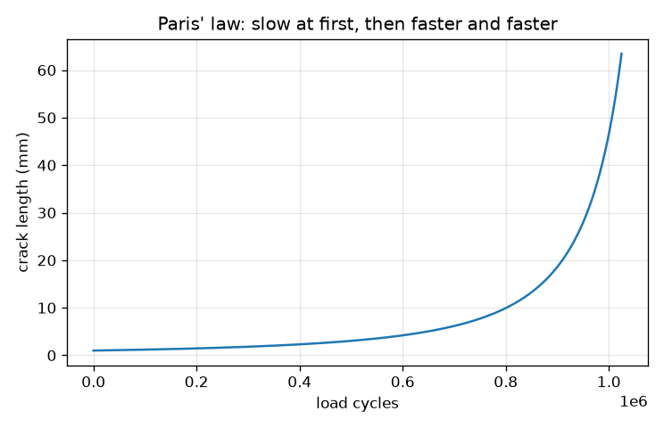
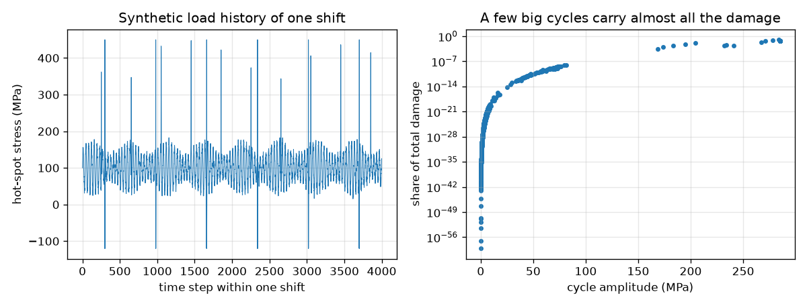
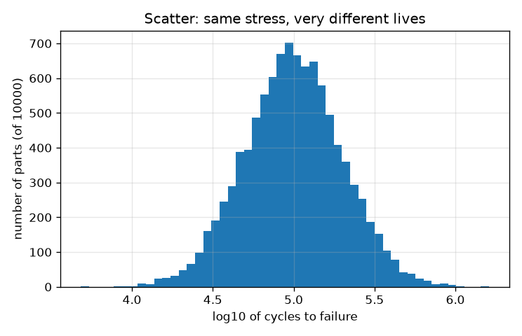

# Session 3: Variable loads, cracks and scatter: a life estimate

*Level 3 (simulation and validation) · about 90 minutes · openfatigue*

> This is a simplified educational model. It is not a validated design tool and must not be used for real structures, electrical installations, vehicles, industrial processes or medical decisions.

**Prerequisites**

- Session 1: the S-N relation.
- Session 2: Goodman equivalent amplitude and the notion of a safety factor.

**Learning objectives.** After this session you can:

- Count the cycles in a messy load history with a rainflow counter and check it on a hand-traced sequence.
- Add up fatigue damage with Miner's rule and say where the rule is weak.
- Integrate Paris' law numerically for crack growth and validate it against the closed form.
- Show the scatter of fatigue life by seeded Monte Carlo and the sensitivity of life to stress, and use all of it for a bracket life and an inspection interval.

## A. Real-world problem
A bracket on a vibrating machine does not see a neat sine wave: it sees vibration, start-ups and now and then a hard knock. How many shifts will it last, and how often must it be inspected for cracks? Real life prediction stacks several ideas: count the cycles, add up their damage, and, once a crack exists, grow it. And two parts made alike never fail together. (Educational model with illustrative numbers; never a method for certifying real or safety-critical parts.)

## B. Concept and theory
Rainflow counting turns a history into cycles. After reducing it to its turning points (reversals), the standard three-point rule (ASTM E1049) keeps a stack: if the newest range X is at least the previous range Y, then Y is a closed loop and counts as one full cycle, or one half cycle if it contains the start of the history; the leftover points at the end count as half cycles. Miner's rule is the standard linear damage rule: a block of n_i cycles at a level with life N_i uses up n_i / N_i of the life, and failure is predicted when D = sum n_i / N_i reaches 1. It ignores load order and interaction between levels, and in tests D at failure scatters widely, roughly 0.3 to 3, so it is an estimate. Crack growth follows Paris' law da/dN = C (delta K)^m with delta K = Y delta_sigma sqrt(pi a); for constant Y and m not equal to 2 the cycles from a0 to the critical length a_c are N = (a_c^(1 - m/2) - a0^(1 - m/2)) / (C Y^m delta_sigma^m pi^(m/2) (1 - m/2)). The critical length comes from K_max = K_Ic. Fatigue life is lognormal: log10 N is normal around its prediction. Because N goes as stress to the power 1/b, a stress change by a factor r changes life by r^(1/b): note the exponent is 1/b, not b.

| Symbol | Meaning | Unit |
|---|---|---|
| range, mean | range and mean of a rainflow cycle | MPa |
| n_i, N_i | applied cycles and life at level i | cycles |
| D | Miner damage sum | no unit |
| a, a0, a_c | crack length, initial and critical | m |
| delta K | stress-intensity range | MPa sqrt(m) |
| C, m | Paris constants (6.9e-12 and 3 for steel in these units) | see text |
| Y | crack shape factor (1.12, small edge crack) | no unit |
| K_Ic | fracture toughness (50 here) | MPa sqrt(m) |
| sigma_log10 | scatter of log10 N (0.3 here) | no unit |

**Assumptions**

- Linear damage (Miner) with Goodman for mean stress; cycles below S_e are kept on the extended line ('extend') unless stated.
- Paris' law with constant C, m and Y; no crack closure and no load-sequence effects.
- The stress history is synthetic; hot-spot stress = 0.1 MPa per newton (assumed).
- Scatter width 0.3 in log10 N is an illustration, not a measured value.
- Simplified model: never for real or safety-critical parts.

$$ D=\sum_i \frac{n_i}{N_i},\qquad \text{failure predicted at } D=1 $$

$$ \frac{da}{dN}=C(\Delta K)^m,\qquad \Delta K=Y\,\Delta\sigma\sqrt{\pi a} $$

$$ N=\frac{a_c^{\,1-m/2}-a_0^{\,1-m/2}}{C\,Y^m\,\Delta\sigma^m\,\pi^{m/2}\,(1-m/2)},\quad m\neq 2 $$

$$ a_c=\left(\frac{K_{Ic}}{Y\,\sigma_{\max}\sqrt{\pi}}\right)^2,\qquad \frac{N_2}{N_1}=r^{1/b} $$

## C. Visual explanation
The first figure shows the synthetic stress history of one shift next to a scatter of every counted cycle's share of the total damage on a logarithmic axis: a handful of large cycles carry almost all of the damage. The second figure is the crack growth curve: a 1 mm crack grows slowly, then faster and faster, to its critical length of 63.4 mm after about 1.02 million cycles at a 100 MPa stress range. The third is a histogram of 10,000 simulated lives for a part with a median life of 100,000 cycles: the lives spread over a factor of about 10 between the 5th and 95th percentile.

*Paris' law crack growth from 1 mm to the critical length: slow at first, then accelerating.*

*One shift of stress (left) and the share of damage of every rainflow cycle (right): a few big cycles dominate.*

*10,000 simulated lives with a median of 100,000 cycles and a spread of 0.3 in log10 N.*

## D. Interactive simulation
Run the lesson (`python start.py 3`), then open the live app: [Session 3: crack growth by Paris' law](https://krunalpanchal1995.github.io/openfatigue/session-03/) (or `app.html` in this folder). Raise the stress range and watch the crack life fall steeply, then raise the toughness K_Ic to see the critical crack get larger. Switch to the life-against-stress view to see that the log of life falls steadily as stress rises.

**Challenge.** Reach a crack life of at least 2 million cycles while starting from a crack of at least 2 mm.

## E. Worked example and experiment
**Problem.** A part has seen 10,000 cycles at an amplitude of 400 MPa and 50,000 cycles at 350 MPa (fully reversed, S_u = 600 MPa, S_e = 300 MPa). By Miner's rule, how much of its life is used, and how many more cycles at 400 MPa can it take?

1. Lives from the S-N line: N(400) = 34,017 cycles and N(350) = 163,392 cycles.
2. Damage at 400 MPa: 10,000 / 34,017 = 0.294. Damage at 350 MPa: 50,000 / 163,392 = 0.306.
3. Total D = 0.294 + 0.306 = 0.600, so 60 percent of the life is used and 0.400 remains.
4. More cycles at 400 MPa: 0.400 x 34,017 = 13,607 cycles (about 13,600).
5. Sanity check: if the order were reversed the sum would be the same, which is exactly Miner's weakness: real parts care about order.

**Answer.** D = 0.600 used; about 13,600 more cycles at 400 MPa remain.

**Experiment.** Compare a test on one bar at constant amplitude to failure with a test that alternates low and high blocks until failure: measured Miner sums usually fall between about 0.3 and 3 rather than at exactly 1, and the high-first order usually gives a smaller sum than low-first. Model and experiment differ because damage is not linear, it interacts with load order (overloads leave residual stresses that slow or speed later cracks) and because the scatter of fatigue life is itself large.

## Real-world application and mini-project: Bracket life and inspection interval from a load history
A bracket on a vibrating machine has a measured hot-spot stress history for one shift (here a synthetic one from `bracket_history()`: steady vibration, 10 start-ups and a few hard knocks). Count its cycles with `rainflow`, add the damage with `miner_damage`, and turn it into a life in shifts. Then use Paris' law to find the number of shifts a crack needs to grow from a detectable size of 0.5 mm to the critical size, divide by a safety factor of 3, and report an inspection interval. Finally a customer requires a life of at least 4,000 shifts: find the largest number of hard knocks per shift (0 to 14) the machine may produce.

**Deliverable:** A script that prints cycles per shift, damage per shift, life in shifts, the equivalent stress range, the critical crack length, the inspection interval, and a table of life against the number of knocks per shift with the largest passing value marked; plus a picture of the history and of the damage against cycle amplitude.

**Success looks like:** Your numbers match the checkpoint: 920.5 cycles per shift, damage 2.0e-4 per shift (life about 4,998 shifts), critical crack 3.13 mm, inspection every 252 shifts (use 250), and 7 knocks per shift as the largest number that still gives at least 4,000 shifts (4,310 shifts).

## F. Assessment and design challenge
**Question type A: Conceptual.** Give two reasons why Miner's rule can be wrong, and say whether ignoring cycles below the endurance limit is safe when large overloads are also present.

Hint

Think of load order, residual stress and what a large overload does to a crack.

Step-by-step solution

(1) Miner ignores the order of loads: a large cycle early can create residual stress or a small crack that makes later small cycles damaging, so cycles below S_e that are harmless alone become damaging. (2) It assumes damage is linear and independent of level, but real cracks grow faster as they get longer, and in tests the sum at failure ranges roughly from 0.3 to 3. So ignoring cycles below S_e is not safe in general when overloads occur: those cycles can then contribute. For our bracket the 'extend' and 'ignore' modes differ little (4,998 against 5,046 shifts) because the overloads dominate, but that has to be checked, not assumed.

**Question type B: Numerical.** An edge crack (Y = 1.12) in a part sees a stress range of 80 MPa (zero to maximum). Using C = 6.9e-12, m = 3 and K_Ic = 50 MPa sqrt(m), find delta K for a0 = 2 mm, the critical length and the life in cycles.

Hint

delta K = Y delta_sigma sqrt(pi a); a_c = (K_Ic / (Y sigma_max sqrt(pi)))^2; then the closed form with m = 3.

Step-by-step solution

delta K at 2 mm = 1.12 x 80 x sqrt(pi x 0.002) = 7.10 MPa sqrt(m). a_c = (50 / (1.12 x 80 x 1.7725))^2 = 0.0991 m = 99.1 mm. Life from the closed form = 1,388,293 cycles, about 1.39 million. Sanity check: delta K at a0 is far below the toughness 50, so most of the life is spent while the crack is still short.

**Question type C: Graph and simulation interpretation.** In the scatter histogram the 5th percentile life is 31,000 cycles and the 95th is 311,000 for a median of 100,000. What does the spread say about testing one part, and what ratio of 95th to 5th percentile do you read off?

Hint

Divide the two percentiles; compare with 10^(2 x 1.645 x 0.3).

Step-by-step solution

The ratio is about 9.9, nearly a factor 10 (theory for a normal log10 N with width 0.3: 10^(2 x 1.645 x 0.3) = 9.7). One test part could fail at a third of the median or last three times longer, so one test says very little: designers use many parts and a low-percentile life. The 1st percentile life is only about 0.19 of the median.

**Question type D: Design and optimisation challenge.** Design: the bracket's life is 4,998 shifts with 6 hard knocks per shift. A customer needs at least 4,000 shifts. How many knocks per shift may the machine produce at most? And the inspection method can find a crack of 1 mm instead of 0.5 mm: what happens to the interval, and what if it can only find 2 mm?

Hint

Run `bracket_history(n_knocks=k)` with `rainflow` and `miner_damage` for k = 0 to 14, and `inspection_interval_shifts(stress, a_detect)` for 0.5, 1 and 2 mm.

Step-by-step solution

Life against knocks: 0 gives 56,607 shifts, 6 give 4,998, 7 give 4,310, 8 give 3,799, 12 give 2,781. So at most 7 knocks per shift keep life at 4,000 shifts or more. The inspection interval (shifts for a crack to grow from the detectable length to the critical length 3.13 mm, divided by 3) is 252 shifts for 0.5 mm, 129 for 1 mm and only 42 for 2 mm: a poor detection method leaves almost no growth window, so inspections must be far more frequent. Trade-offs: fewer knocks (better operation or a damper), better inspection (cost), or a stronger bracket (a lower hot-spot stress). Assumptions: synthetic history, Miner's rule, constant Paris constants, safety factor 3.

Score yourself with [RUBRIC.md](../../RUBRIC.md). Print the [activity sheet](activity_sheet.md) to work on paper.

## Common misconceptions
| Common misconception | What is actually true |
|---|---|
| Small cycles matter as much as big ones because there are so many of them. | Damage grows as a high power of the amplitude. In the bracket 9.5 of 920.5 cycles (about 1 percent) above 250 MPa carry 96.7 percent of the damage. |
| Miner's rule is exact: D = 1 means failure. | It is a standard but rough rule; D at failure in tests scatters from about 0.3 to 3, and it ignores load order. |
| Once a crack is found the part must be scrapped at once. | A crack takes many cycles to grow; with Paris' law we can estimate the remaining life and schedule inspections (here a 0.5 mm crack takes about 3 x 252 shifts to become critical). |
| A 10 percent stress increase costs about 10 percent of the life. | In the S-N region a 10 percent increase multiplies life by 1.1^(1/b) = 0.326, a cut of 67 percent; the exponent is 1/b, not b. In Paris crack growth it is 1.1^-3 = 0.751, a 25 percent cut. |

## Glossary
- **rainflow counting**: a standard method that turns a load history into full and half cycles
- **reversal**: a peak or valley of the history, a point where the load changes direction
- **Miner's rule**: the linear damage sum D = sum n_i / N_i; failure is predicted at D = 1
- **Paris' law**: da/dN = C (delta K)^m, the growth of a fatigue crack per cycle
- **fracture toughness**: K_Ic, the stress intensity at which a crack runs unstably
- **lognormal**: a distribution in which the logarithm of the quantity is normal; typical for fatigue life
- **Monte Carlo**: estimating a spread by running many random trials with a fixed seed

## Finish
1. Do the three coding tasks in [exercises.md](exercises.md).
2. Run `python start.py 3` again after your changes. It ends with the checkpoint; when it prints `PASS`, you are done. (Checkpoint only: `python start.py check 3`.)

Next: the [roadmap](../../promo/roadmap.md). Session 4 is yours to build.
